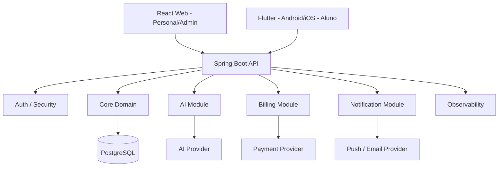
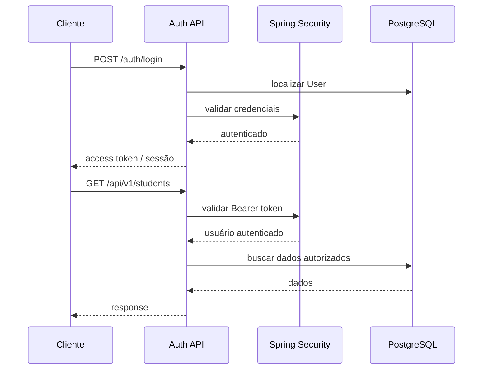
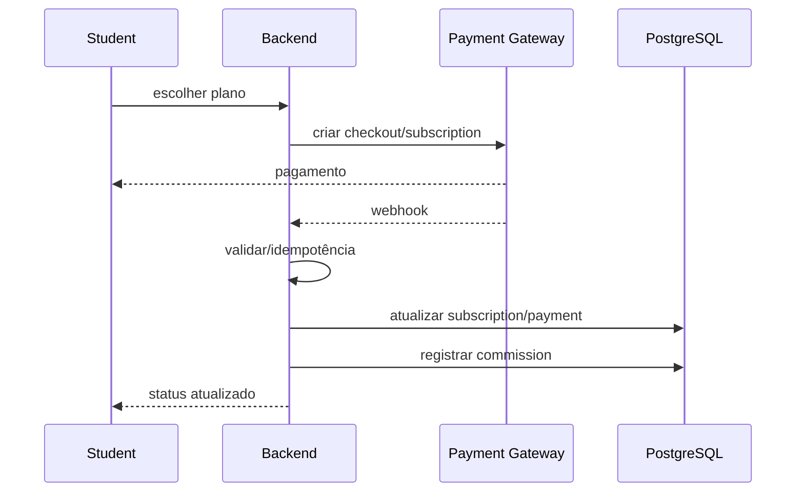
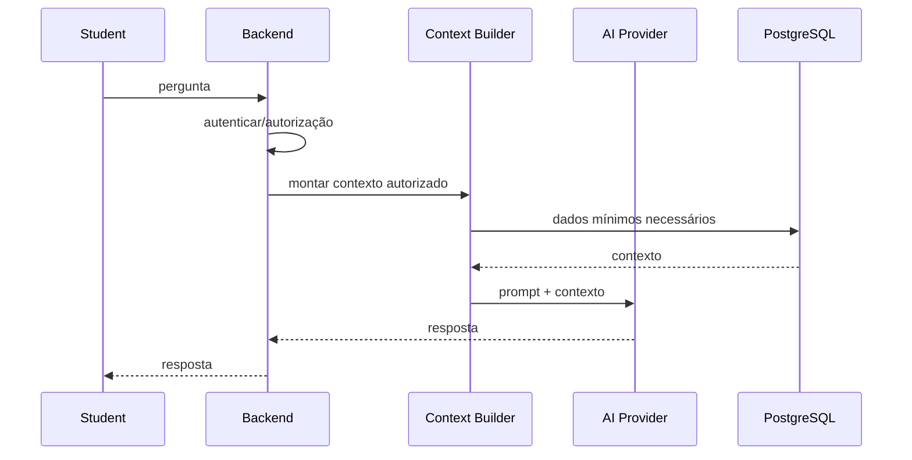

# GymManager — Arquitetura, System Design, Produto e Regras de Negócio

> Documento de referência do produto e do desenvolvimento.
>
> **Status:** arquitetura inicial / em definição  
> **Objetivo:** transformar o atual GymManager, que começou como projeto de CRUD e estudo, em uma plataforma de gestão para personal trainers e alunos, com aplicativo mobile, painel web, IA, assinaturas e pagamentos.

---

## 1. Visão do produto

O GymManager evolui para uma plataforma que conecta **personal trainers** e **alunos**.

A proposta não é apenas oferecer um gerenciador de treinos. A plataforma deve centralizar o relacionamento entre personal e aluno, facilitando:

- criação e gerenciamento de treinos;
- acompanhamento da execução dos treinos;
- comunicação entre personal e aluno;
- acompanhamento de evolução;
- suporte ao aluno por um assistente de IA contextualizado;
- assinatura e cobrança dos alunos;
- repasse financeiro ao personal;
- administração da plataforma.

A plataforma terá dois produtos de interface principais:

1. **Painel Web do Personal** — React + TypeScript.
2. **Aplicativo Mobile do Aluno** — Flutter + Dart, Android e iOS.

Ambos consumirão a mesma API REST em Java/Spring Boot.

---

## 2. Decisão arquitetural principal

### 2.1 Backend

Manter o backend existente:

- Java 25;
- Spring Boot;
- Spring Web;
- Spring Data JPA;
- Hibernate;
- PostgreSQL;
- Maven.

A arquitetura inicial será um **monólito modular**.

Não iniciar com microsserviços.

### 2.2 Web

Manter o frontend web existente:

- React;
- TypeScript;
- Vite;
- React Router.

O painel web será direcionado principalmente aos **personais** e, futuramente, à administração da plataforma.

### 2.3 Mobile

Criar uma aplicação nova em:

- Flutter;
- Dart;
- Android;
- iOS.

O aplicativo mobile será focado principalmente na experiência do aluno.

O Flutter possui uma orientação oficial de arquitetura que enfatiza separação de responsabilidades entre UI e camada de dados; essa separação será usada como referência e adaptada ao produto.

### 2.4 Comunicação

```text
                    ┌──────────────────────┐
                    │      PostgreSQL      │
                    └──────────▲───────────┘
                               │
                       Spring Boot API
                               │
                 ┌─────────────┴─────────────┐
                 │                           │
         React Web                     Flutter Mobile
       Personal/Admin                    Aluno
```

O frontend web e o aplicativo mobile **não acessam o banco diretamente**.

Todas as regras importantes passam pela API.

---

# 3. Por que monólito modular?

O produto começa como uma única aplicação Spring Boot, mas organizada por domínios.

```text
Spring Boot
│
├── auth
├── trainer
├── student
├── workout
├── exercise
├── billing
├── ai
├── notification
└── admin
```

Isso permite aprender e entregar o produto sem introduzir a complexidade de microsserviços cedo demais.

### Vantagens neste estágio

- desenvolvimento mais simples;
- debugging mais simples;
- transações locais mais fáceis;
- deploy inicial mais simples;
- menor custo operacional;
- menos infraestrutura;
- fácil evolução do projeto atual.

### O que evitar

Não criar automaticamente:

```text
Auth Service
Workout Service
Billing Service
AI Service
Notification Service
```

Cada serviço separado adicionaria comunicação de rede, observabilidade, autenticação entre serviços, deploy independente, falhas distribuídas e outros problemas.

### Evolução futura

Caso o produto cresça muito, determinados módulos podem ser extraídos para serviços independentes posteriormente.

A arquitetura deve deixar essa possibilidade aberta, mas **não implementar microsserviços antecipadamente**.

---

# 4. Estrutura geral do repositório

Estrutura proposta:

```text
gymmanager/
│
├── src/                         # Spring Boot
│   └── main/java/.../
│       ├── auth/
│       ├── trainer/
│       ├── student/
│       ├── exercise/
│       ├── workout/
│       ├── billing/
│       ├── ai/
│       ├── notification/
│       ├── admin/
│       ├── exception/
│       └── common/
│
├── frontend/                    # React Web
│   └── src/
│       ├── components/
│       ├── pages/
│       ├── features/
│       ├── services/
│       ├── types/
│       └── ...
│
├── mobile/                      # Flutter
│   ├── lib/
│   │   ├── core/
│   │   ├── features/
│   │   └── ...
│   └── test/
│
├── docs/
├── pom.xml
├── README.md
└── CLAUDE.md
```

A estrutura poderá evoluir. O princípio é manter a separação clara entre backend, web, mobile e documentação.

---

# 5. Arquitetura do backend

O backend deve manter separação de responsabilidades.

Estrutura conceitual de um módulo:

```text
feature/
├── controller/
├── application/
├── domain/
├── repository/
├── dto/
└── mapper/
```

No projeto existente, `Service` pode continuar sendo utilizado como camada de aplicação. Não é necessário renomear todos os serviços apenas para seguir uma nomenclatura de livro.

### Controller

Responsável por:

- receber HTTP;
- validar entrada em conjunto com Bean Validation;
- chamar a aplicação;
- devolver status HTTP e DTOs.

O Controller não deve concentrar regra de negócio.

### Service/Application

Responsável por:

- executar casos de uso;
- coordenar repositórios;
- aplicar regras de negócio;
- controlar transações;
- coordenar integrações.

### Repository

Responsável pelo acesso aos dados.

Não colocar regras de negócio complexas no repository apenas para economizar linhas no service.

### Entity/Domain

Representa estado e invariantes do domínio.

Não expor entidades JPA diretamente na API quando isso criar acoplamento ou risco de exposição de dados.

### DTOs

Representam contratos de entrada e saída da API.

O frontend não deve depender da estrutura interna das entidades JPA.

---

# 6. Domínio e usuários

## 6.1 User

`User` representa a conta de autenticação.

Conceito:

```text
User
├── id
├── email
├── passwordHash
├── role
├── active
├── createdAt
└── updatedAt
```

Senha nunca deve ser armazenada em texto puro.

## 6.2 TrainerProfile

Representa o perfil profissional do personal.

Exemplos de dados:

- nome de exibição;
- foto;
- descrição;
- telefone;
- registro profissional, quando aplicável;
- informações comerciais;
- preferências;
- status.

## 6.3 StudentProfile

Representa o perfil do aluno.

Exemplos:

- nome;
- foto;
- data de nascimento;
- dados usados no acompanhamento;
- objetivo;
- preferências;
- informações relevantes fornecidas pelo próprio usuário.

Dados sensíveis devem ser tratados com controle de acesso reforçado.

## 6.4 TrainerStudent

Representa a relação entre personal e aluno.

```text
Trainer
   │
   │ 1:N
   ▼
TrainerStudent
   ▲
   │ N:1
   │
Student
```

Possíveis estados:

```text
INVITED
ACTIVE
PAUSED
CANCELED
```

Não apagar fisicamente relações históricas sem avaliar impacto em auditoria, cobrança e histórico de treino.

---

# 7. Roles e autorização

Papéis iniciais:

```text
PLATFORM_ADMIN
TRAINER
STUDENT
```

### PLATFORM_ADMIN

Responsável pelas funções administrativas da plataforma.

### TRAINER

Pode acessar e administrar os recursos dos próprios alunos e seu negócio.

### STUDENT

Pode acessar apenas seus próprios dados e recursos disponibilizados a ele.

## Regra crítica

Nunca confiar apenas no ID recebido pela URL.

Exemplo:

```http
GET /students/15
```

Não significa automaticamente que o usuário autenticado pode acessar o aluno 15.

O backend deve verificar:

```text
Usuário autenticado?
      ↓
É um TRAINER?
      ↓
O aluno 15 pertence a esse TRAINER?
      ↓
SIM → permite
NÃO → 403
```

Essa regra deve existir no backend mesmo que o frontend esconda botões.

---

# 8. Segurança e autenticação

Arquitetura desejada:

```text
Flutter / React
      │
      │ POST /auth/login
      ▼
Spring Security
      │
      ▼
AuthenticationManager
      │
      ▼
User + PasswordEncoder
      │
      ▼
JWT
      │
      ▼
Cliente
      │
      │ Authorization: Bearer <token>
      ▼
Spring Security Resource Server
      │
      ▼
Controller
```

Spring Security possui suporte a Resource Server com JWT, incluindo validação de Bearer Tokens. Na configuração de um Resource Server JWT, a documentação oficial destaca o uso de `spring-security-oauth2-resource-server` e `spring-security-oauth2-jose`.

Spring Security não fornece automaticamente um endpoint de emissão de token; a aplicação deve implementar o fluxo de autenticação ou integrar um Authorization Server/IdP, enquanto o framework fornece recursos para codificação e validação de JWT.

## Regras

- senha com `PasswordEncoder`;
- nunca retornar passwordHash em DTO;
- segredo/chaves fora do Git;
- token com expiração;
- validar assinatura e claims;
- proteger endpoints por autenticação;
- proteger operações administrativas por autorização;
- evitar armazenar tokens de forma insegura no mobile;
- não confiar em role enviada pelo frontend.

Para produção, avaliar cuidadosamente estratégia de refresh token e armazenamento seguro de credenciais/tokens.

---

# 9. Exercícios

`Exercise` representa um exercício da biblioteca.

Não deve conter atributos que pertencem a uma execução específica.

Exemplo:

```text
Exercise
├── id
├── name
├── muscleGroup
└── description
```

Não colocar:

```text
sets
reps
rest
weight
```

na entidade global do exercício quando esses dados pertencem ao treino ou à execução.

---

# 10. Treinos: separar planejamento de execução

O modelo atual precisa evoluir para separar conceitos.

```text
WorkoutPlan
     │
     │ contém
     ▼
WorkoutPlanExercise
     │
     │ é atribuído para
     ▼
WorkoutAssignment
     │
     │ é executado como
     ▼
WorkoutSession
     │
     ▼
ExercisePerformance
```

## WorkoutPlan

Template/plano criado pelo personal.

## WorkoutPlanExercise

Exercício dentro do plano.

Pode conter:

- ordem;
- séries;
- repetições;
- descanso;
- carga alvo;
- observação;
- progressão futura.

## WorkoutAssignment

Representa a atribuição de um plano para um aluno.

Isso permite histórico mesmo que o plano original seja posteriormente alterado.

## WorkoutSession

Representa uma execução real.

Exemplo:

```text
Aluno iniciou treino A
→ iniciou às 18:03
→ finalizou às 19:02
```

## ExercisePerformance

Representa aquilo que foi realmente executado.

Exemplo:

```text
Exercício: Supino
Série 1: 12 reps / 20kg
Série 2: 10 reps / 25kg
```

Isso permite gerar evolução no futuro.

---

# 11. Produto do Personal — Web

O painel web será a ferramenta principal do personal.

## Dashboard

Indicadores possíveis:

- alunos ativos;
- novos alunos;
- alunos sem treino recente;
- treinos concluídos;
- adesão aos treinos;
- receita recorrente;
- assinaturas ativas;
- pagamentos pendentes;
- mensagens pendentes.

Evitar criar métricas apenas para enfeitar o dashboard. Cada indicador deve ser útil para uma decisão.

## Alunos

Funcionalidades:

- listar;
- pesquisar;
- filtrar;
- visualizar perfil;
- convidar;
- ativar/pausar vínculo;
- acessar treinos;
- acompanhar evolução;
- acessar assinatura;
- iniciar conversa.

## Treinos

- criar;
- editar;
- duplicar;
- ordenar exercícios;
- atribuir ao aluno;
- arquivar;
- acompanhar histórico.

## Financeiro

- criar plano comercial;
- definir preço;
- visualizar assinaturas;
- visualizar pagamentos;
- visualizar comissão;
- acompanhar repasses.

---

# 12. Aplicativo do Aluno — Flutter

A experiência mobile é centrada no uso durante o dia a dia do aluno.

## Telas iniciais

```text
Splash
Login
Onboarding
Home
Meu treino
Executar treino
Histórico
Evolução
Chat
IA
Assinatura
Perfil
Configurações
```

## Treino do dia

A tela deve priorizar velocidade e simplicidade.

O aluno precisa conseguir:

1. abrir o treino;
2. ver o exercício;
3. visualizar instruções;
4. registrar o que executou;
5. passar para o próximo;
6. finalizar o treino.

Não transformar o fluxo de execução em um formulário enorme.

---

# 13. Arquitetura Flutter

A aplicação seguirá separação de responsabilidades.

Sugestão:

```text
mobile/lib/
│
├── core/
│   ├── network/
│   ├── storage/
│   ├── routing/
│   ├── theme/
│   ├── errors/
│   └── utils/
│
└── features/
    ├── auth/
    ├── home/
    ├── workouts/
    ├── progress/
    ├── chat/
    ├── ai/
    ├── billing/
    └── profile/
```

Cada feature pode ter:

```text
feature/
├── presentation/
├── application/
├── domain/
└── data/
```

### Presentation

Widgets, telas e estado de UI.

### Application

Casos de uso e coordenação.

### Domain

Modelos e contratos independentes de UI.

### Data

API, DTOs, repositories e armazenamento local.

O objetivo é evitar colocar chamadas HTTP diretamente dentro dos widgets.

A separação de responsabilidades também é um princípio central nas recomendações oficiais de arquitetura do Flutter.

---

# 14. Comunicação API entre Web e Mobile

A API deve ser agnóstica em relação ao frontend.

```text
            REST API
               │
       ┌───────┴────────┐
       │                │
     React            Flutter
```

O backend não deve saber se uma requisição veio de web ou mobile apenas para aplicar regra de negócio.

Exceções podem existir para recursos específicos de plataforma, mas não devem ser a regra.

---

# 15. Convenções de API

Prefixo sugerido:

```text
/api/v1
```

Exemplos:

```text
POST   /api/v1/auth/login
GET    /api/v1/trainers/me
GET    /api/v1/students
GET    /api/v1/students/{id}
POST   /api/v1/students
GET    /api/v1/workout-plans
POST   /api/v1/workout-plans
POST   /api/v1/workout-assignments
POST   /api/v1/workout-sessions
GET    /api/v1/subscriptions
POST   /api/v1/conversations
POST   /api/v1/ai/messages
```

Os endpoints exatos podem evoluir junto com o domínio.

## Paginação

Listas grandes devem suportar paginação.

Exemplo:

```text
?page=0&size=20&sort=name,asc
```

Evitar endpoints que devolvam milhares de registros sem paginação.

---

# 16. DTOs e contratos

Nunca expor diretamente:

- `passwordHash`;
- secrets;
- dados internos de pagamento;
- dados administrativos que o cliente não deveria conhecer;
- entidades inteiras sem necessidade.

Exemplo:

```text
UserEntity
     ↓
UserResponse
```

O DTO deve representar o contrato público.

---

# 17. Exceções

Usar `@RestControllerAdvice`.

Resposta padrão:

```json
{
  "status": 404,
  "message": "Aluno não encontrado",
  "timestamp": "2026-09-17T22:00:00Z",
  "path": "/api/v1/students/123"
}
```

Principais códigos:

| Código | Uso |
|---:|---|
| 200 | sucesso com conteúdo |
| 201 | recurso criado |
| 204 | sucesso sem conteúdo |
| 400 | requisição/validação inválida |
| 401 | não autenticado |
| 403 | autenticado, mas sem permissão |
| 404 | recurso inexistente |
| 409 | conflito/regra de negócio |
| 500 | erro inesperado |

Não transformar todos os erros em `500` e não expor stack trace ao cliente.

---

# 18. Bean Validation

Validar DTOs de entrada.

Exemplos:

```java
@NotBlank
private String name;

@Email
private String email;

@Positive
private BigDecimal price;
```

O backend deve ser responsável pela validação, mesmo que o frontend também valide para melhorar a UX.

Frontend validation é experiência do usuário.

Backend validation é regra de segurança e integridade.

---

# 19. Regras de negócio financeiras

## Plano do personal

Cada personal pode possuir planos comerciais.

Exemplo:

```text
Plano Premium
R$ 149,90 / mês
```

## Comissão

A plataforma possui uma comissão configurável.

Exemplo conceitual:

```text
Valor da assinatura: R$ 149,90
Comissão: 10%
Comissão plataforma: R$ 14,99
Repasse personal: R$ 134,91
```

O percentual aplicado deve ser registrado junto do evento financeiro.

Se a comissão futura mudar para 12%, uma assinatura antiga não deve ser recalculada retroativamente.

## Idempotência

Webhooks e operações financeiras devem ser idempotentes.

Se o mesmo webhook chegar duas vezes, o sistema não pode gerar dois pagamentos ou duas comissões.

---

# 20. Billing — estados

### Subscription

```text
TRIAL
PENDING
ACTIVE
PAST_DUE
PAUSED
CANCELED
EXPIRED
```

### Payment

```text
PENDING
AUTHORIZED
PAID
FAILED
REFUNDED
CHARGEBACK
CANCELED
```

Os nomes podem ser ajustados conforme o gateway.

O estado interno do sistema não deve depender diretamente da nomenclatura específica do provedor.

---

# 21. Abstração de pagamento

Usar interface/adaptador:

```text
PaymentGateway
      │
      ├── ProviderA
      └── ProviderB
```

O domínio chama `PaymentGateway`, não uma API específica.

Isso permite trocar o gateway sem reescrever o domínio inteiro.

Nunca confiar no frontend para confirmar pagamento.

A confirmação deve vir do backend, preferencialmente de mecanismo oficial do provedor, como webhook/evento validado.

---

# 22. Assistente de IA

A IA deve ser uma capacidade do produto, não o centro de todas as regras.

Arquitetura:

```text
Student
   ↓
AI Controller
   ↓
AI Application Service
   ↓
Context Builder
   ↓
AI Provider Adapter
   ↓
LLM Provider
```

## Context Builder

Seleciona somente os dados necessários.

Exemplo:

```text
Objetivo do aluno
Treino atual
Exercício atual
Observações do personal
Histórico relevante
Pergunta
```

## Provider Adapter

Abstração para trocar o modelo/provedor.

```text
AiProvider
   ├── ProviderA
   └── ProviderB
```

## Segurança

A IA não deve ter acesso irrestrito ao banco.

Ela recebe somente o contexto autorizado.

Não enviar:

- senha;
- tokens;
- dados de pagamento;
- informações de outros alunos;
- dados administrativos;
- qualquer dado que não seja necessário à tarefa.

---

# 23. Regras da IA

Primeira versão: IA somente leitura.

Ela pode:

- explicar exercícios;
- explicar conceitos de treino;
- orientar dúvidas gerais relacionadas ao treino;
- responder com base no contexto permitido;
- sugerir adaptações para conversa com o personal.

Ela não pode automaticamente:

- alterar treino;
- alterar preço;
- cancelar assinatura;
- criar pagamento;
- conceder acesso;
- mudar permissões;
- acessar dados de terceiros.

Futuras ações de IA devem passar por ferramentas explícitas e autorização.

Exemplo futuro:

```text
IA sugere mudança
      ↓
personal aprova
      ↓
WorkoutPlan atualizado
```

Isso é preferível a dar autonomia total desde a primeira versão.

---

# 24. Chat

Estrutura:

```text
Conversation
├── participants
└── messages
      ├── STUDENT
      ├── TRAINER
      └── AI
```

Cada mensagem deve possuir origem identificável.

Isso evita confundir uma resposta da IA com uma mensagem do personal.

Futuro:

- mensagens lidas;
- anexos;
- push;
- busca;
- moderação;
- mensagens automáticas do sistema.

---

# 25. Notificações

Eventos possíveis:

```text
Treino atribuído
Treino próximo
Treino concluído
Mensagem recebida
Resposta da IA disponível
Pagamento aprovado
Pagamento falhou
Assinatura próxima do vencimento
```

A notificação deve ser disparada por evento de negócio, e não diretamente espalhada por todos os controllers.

Futuro:

```text
Domain Event
   ↓
Notification Service
   ├── Push
   ├── E-mail
   └── outros canais
```

---

# 26. Arquitetura assíncrona futura

No começo, não adicionar Kafka ou RabbitMQ apenas para “parecer profissional”.

Quando houver necessidade real de tarefas assíncronas, evoluir para:

```text
Request
  ↓
Transaction
  ↓
Outbox Event
  ↓
Worker/Consumer
  ↓
Notificação / IA / integração
```

Um padrão de **Transactional Outbox** pode ser introduzido quando houver eventos que não podem ser perdidos entre a transação do banco e o processamento assíncrono.

Exemplo:

```text
SubscriptionActivated
WorkoutCompleted
PaymentConfirmed
```

---

# 27. Observabilidade

Adicionar gradualmente:

- logs estruturados;
- request correlation ID;
- Spring Boot Actuator;
- health checks;
- métricas;
- monitoramento de banco;
- rastreamento de falhas;
- monitoramento de jobs e webhooks.

Nunca logar:

- senha;
- JWT completo;
- chave de API;
- segredo de pagamento;
- dados financeiros sensíveis;
- dados pessoais desnecessários.

---

# 28. Testes

## Backend

### Unitários

- services;
- regras de negócio;
- cálculo de comissão;
- autenticação;
- autorização;
- validações complexas.

### Integração

- controllers;
- repositories;
- segurança;
- PostgreSQL.

### Ferramentas

- JUnit 5;
- Mockito;
- AssertJ;
- Spring Boot Test;
- Testcontainers.

## Mobile

- unit tests;
- widget tests;
- integration tests para fluxos críticos.

## Web

Testar principalmente fluxos importantes e componentes que possuem lógica relevante.

### Objetivo

Não buscar “100% de cobertura” por obrigação.

Cobrir principalmente regras que, se quebradas, causariam dano ao usuário ou ao negócio.

---

# 29. Banco de dados e migrations

PostgreSQL continuará sendo o banco principal.

Para evolução do projeto, utilizar migrations versionadas, preferencialmente Flyway.

A sequência desejada é:

```text
Código
  ↓
Migration
  ↓
Banco
```

Evitar depender de `ddl-auto=update` em produção.

Durante a fase de estudo, pode ser mantido no ambiente local conforme necessidade, mas o projeto deve evoluir para schema versionado antes do deploy sério.

---

# 30. Cache

Não adicionar Redis sem necessidade real.

Possíveis usos futuros:

- rate limiting;
- cache de dados muito acessados;
- sessões/blacklist quando necessário;
- jobs distribuídos;
- cache de contexto não sensível.

No início, PostgreSQL é suficiente para a maior parte do domínio.

---

# 31. Segurança operacional

Secrets devem ser fornecidos por ambiente:

```text
DB_USERNAME
DB_PASSWORD
JWT_SECRET / chave privada
AI_API_KEY
PAYMENT_API_KEY
```

Nunca:

```text
senha="123456"
apiKey="..."
```

em código versionado.

`.env` e secrets locais devem ficar fora do Git.

---

# 32. Privacidade e LGPD

O produto pode manipular dados pessoais e, dependendo das informações coletadas, dados relacionados à saúde. No Brasil, dados referentes à saúde são enquadrados como dados pessoais sensíveis pela LGPD e exigem proteção reforçada.

O projeto deve adotar desde cedo:

- minimização de dados;
- controle de acesso;
- finalidade definida;
- proteção de dados em trânsito;
- proteção de secrets;
- políticas de retenção;
- registros de auditoria quando necessários;
- avaliação do que é enviado ao provedor de IA;
- fluxo de exclusão/retificação conforme requisitos aplicáveis.

Antes da operação comercial, realizar revisão jurídica específica de LGPD, termos de uso, política de privacidade, consentimentos e responsabilidades do produto.

---

# 33. Regras de negócio principais

## Relacionamento personal/aluno

1. Um aluno deve estar vinculado a um personal para receber determinados serviços.
2. Um personal não pode acessar aluno de outro personal sem permissão administrativa apropriada.
3. Um aluno só acessa seus próprios dados.
4. O histórico do vínculo deve ser preservado quando necessário.

## Treinos

1. Exercícios são biblioteca reutilizável.
2. O exercício não guarda séries/repetições da execução.
3. O plano define o que deveria ser feito.
4. A execução registra o que foi feito.
5. Alterar um plano não deve destruir o histórico de execuções anteriores.

## IA

1. IA responde somente dentro do contexto autorizado.
2. IA não modifica dados de negócio automaticamente na primeira versão.
3. IA não substitui avaliação profissional ou médica.
4. Toda função de IA deve ter limites de custo e acesso.

## Pagamentos

1. Frontend nunca confirma pagamento sozinho.
2. Webhook deve ser validado.
3. Webhook deve ser idempotente.
4. Comissão deve ser registrada no evento financeiro.
5. Estornos devem gerar ajustes financeiros apropriados.
6. Dados de cartão não devem ser armazenados pela aplicação se o gateway puder realizar esse processamento.

## Segurança

1. Backend é a fonte de verdade.
2. Não confiar em IDs ou roles fornecidos pelo frontend.
3. Senhas nunca em texto puro.
4. Secrets nunca no repositório.

---

# 34. MVP — o que entra primeiro

O produto é grande. Para não transformar o desenvolvimento em um projeto infinito, o MVP deve ser controlado.

## MVP 1 — Core

- User;
- login;
- roles;
- TrainerProfile;
- StudentProfile;
- vínculo personal/aluno;
- exercícios;
- planos de treino;
- atribuição de treino;
- execução do treino;
- histórico básico.

## MVP 2 — Comunicação

- chat personal/aluno;
- notificações básicas;
- app mobile do aluno.

## MVP 3 — IA

- perguntas sobre treino;
- contexto do aluno;
- respostas sobre exercícios;
- limites de segurança;
- controle de uso/custo.

## MVP 4 — Monetização

- plano do personal;
- assinatura do aluno;
- checkout sandbox;
- webhooks;
- comissão;
- relatório financeiro básico.

## Pós-MVP

- automações;
- analytics avançado;
- IA com ferramentas controladas;
- recomendações avançadas;
- integração com wearables;
- integrações externas;
- marketplace maior;
- microserviços somente se houver necessidade real.

---

# 35. Fora do escopo inicial

Não implementar inicialmente:

- marketplace de suplementos;
- rede social completa;
- feed público;
- streaming complexo de vídeo;
- marketplace de academias;
- microsserviços;
- Kubernetes;
- Kafka sem caso real;
- dezenas de integrações simultâneas;
- IA autônoma alterando treinos;
- diagnóstico médico;
- processamento próprio de cartão.

Isso reduz risco e acelera validação do produto.

---

# 36. Roadmap técnico recomendado

```text
FASE 0
Arquitetura + domínio
        ↓
FASE 1
User + Trainer + Student
        ↓
FASE 2
Spring Security + JWT
        ↓
FASE 3
Exceptions + Validation
        ↓
FASE 4
Testes
        ↓
FASE 5
Workout domain completo
        ↓
FASE 6
Flutter app
        ↓
FASE 7
Chat
        ↓
FASE 8
IA
        ↓
FASE 9
Billing sandbox
        ↓
FASE 10
Docker + CI/CD
        ↓
FASE 11
Deploy
        ↓
FASE 12
Escala / otimizações
```

O roadmap não significa que nenhuma tarefa possa ser antecipada. A ordem existe para evitar dependências quebradas e trabalho duplicado.

---

# 37. System Design — visão de produção futura



Essa arquitetura é suficientemente simples para o estágio atual e deixa caminhos de evolução claros.

---

# 38. System Design — autenticação



---

# 39. System Design — assinatura



---

# 40. System Design — IA



A IA nunca deve receber contexto de outro aluno apenas porque esse dado existe no banco.

---

# 41. Boas práticas de desenvolvimento

## Código

- nomes claros;
- métodos pequenos;
- responsabilidades únicas;
- evitar duplicação real;
- não abstrair prematuramente;
- DTOs para contratos externos;
- `final` onde fizer sentido;
- injeção por construtor;
- transações no nível apropriado do caso de uso.

## Git

Commits pequenos e descritivos.

Exemplos:

```text
feat: adiciona autenticação de usuários
feat: cria vínculo entre personal e aluno
fix: corrige exclusão de treino
refactor: organiza módulo de exercícios
test: adiciona testes do WorkoutService
docs: atualiza arquitetura do projeto
```

## Pull/Change workflow

Mesmo trabalhando sozinho com Claude Code, agir como se houvesse code review:

1. entender o problema;
2. planejar;
3. alterar pouco;
4. testar;
5. revisar diff;
6. commitar;
7. continuar.

---

# 42. Regras específicas para Claude Code

O Claude Code deve usar este documento como especificação do produto, mas **não deve interpretar a documentação como autorização para mudar tudo automaticamente**.

Antes de qualquer mudança grande:

1. analisar a estrutura atual;
2. identificar código existente reutilizável;
3. listar arquivos que serão afetados;
4. apontar possíveis breaking changes;
5. dividir o trabalho em fases;
6. implementar apenas a fase autorizada;
7. executar build/testes;
8. mostrar o resumo e aguardar a próxima etapa.

### Proibições

- não apagar o projeto atual e recriá-lo do zero;
- não substituir o backend por outro framework;
- não trocar PostgreSQL por outro banco sem decisão explícita;
- não trocar React web por outro framework;
- não adicionar microserviços agora;
- não adicionar Kubernetes agora;
- não adicionar Kafka agora sem requisito real;
- não adicionar dezenas de dependências sem necessidade;
- não colocar segredo no código;
- não implementar pagamento real sem sandbox e testes;
- não dar autonomia de escrita para IA no domínio na primeira versão;
- não modificar regras de negócio silenciosamente;
- não quebrar endpoints existentes sem plano de migração.

### Quando o Claude não souber

Parar e explicar a incerteza.

Não inventar campos, endpoints, provedores, tabelas ou regras comerciais que não tenham sido definidos.

---

# 43. Critério de pronto de uma funcionalidade

Uma funcionalidade só deve ser considerada concluída quando, conforme aplicável:

- regra de negócio implementada;
- autorização aplicada;
- validação aplicada;
- exceptions tratadas;
- DTOs revisados;
- testes relevantes criados;
- documentação mínima atualizada;
- frontend integrado;
- estados de loading/erro considerados;
- logs sem dados sensíveis;
- build passando.

Para billing, adicionar ainda:

- webhook;
- idempotência;
- sandbox;
- tratamento de falhas;
- conciliação básica.

Para IA, adicionar ainda:

- limites de contexto;
- limite de custo/uso;
- tratamento de falha do provider;
- proteção contra acesso indevido a dados;
- política de conteúdo e segurança.

---

# 44. Decisões importantes resumidas

| Decisão | Escolha |
|---|---|
| Backend | Java + Spring Boot |
| Banco | PostgreSQL |
| Arquitetura backend | Monólito modular |
| Web | React + TypeScript |
| Mobile | Flutter + Dart |
| API | REST |
| Auth | Spring Security + JWT |
| Migrations | Flyway |
| Testes | JUnit + Mockito + AssertJ + Testcontainers |
| Containers | Docker |
| CI/CD | GitHub Actions |
| IA | Adapter/provider isolado |
| Pagamentos | Adapter/gateway isolado |
| Mensageria | Adicionar só quando houver necessidade |
| Kubernetes | Pós-MVP / se houver necessidade real |
| Microsserviços | Não no início |

---

# 45. Visão de longo prazo

A visão final é uma plataforma onde:

```text
                  PERSONAL
                     │
             cria e acompanha
                     │
                     ▼
                  TREINO
                     │
                     ▼
                   ALUNO
                     │
        ┌────────────┼────────────┐
        ▼            ▼            ▼
      Treino        IA         Personal
                                   │
                                   ▼
                              Comunicação

Aluno
  │
  ▼
Assinatura
  │
  ▼
Plataforma
  ├── Comissão
  └── Repasse Personal
```

O valor do produto estará na combinação de:

**gestão + acompanhamento + comunicação + IA + recorrência financeira.**

O aplicativo não deve ser apenas um “gerenciador de academia”. O objetivo é ser uma ferramenta que reduz o trabalho operacional do personal e melhora a experiência do aluno.

---

# 46. Princípio final

O projeto deve crescer por necessidade real.

A tecnologia não é o produto.

O produto é o relacionamento entre:

```text
Personal
   ↕
Plataforma
   ↕
Aluno
```

A arquitetura deve tornar esse relacionamento seguro, simples, observável e escalável sem introduzir complexidade antes da hora.

---

# 47. Referências técnicas oficiais

Estas referências foram consultadas para orientar os pontos técnicos do documento que dependem da documentação atual das tecnologias.

- Flutter — Guide to app architecture: https://docs.flutter.dev/app-architecture/guide
- Spring Security — OAuth 2.0 Resource Server JWT: https://docs.spring.io/spring-security/reference/servlet/oauth2/resource-server/jwt.html
- Spring Security — OAuth 2.0 overview: https://docs.spring.io/spring-security/reference/servlet/oauth2/
- ANPD / LGPD: https://www.gov.br/anpd/pt-br/assuntos/legislacao
